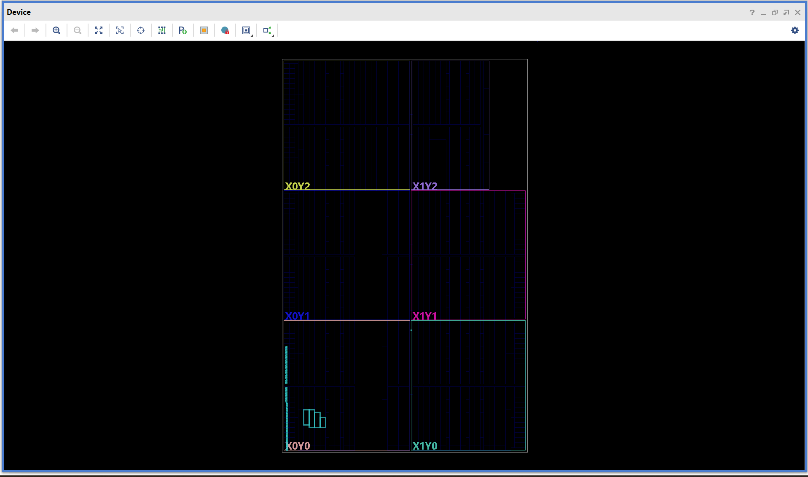

# 4x4 INT8 Matrix Multiplication Engine

A small digital circuit, written in Verilog, that multiplies two 4x4 matrices of signed 8-bit numbers. The design is verified with a self-checking testbench and implemented on a Xilinx Artix-7 FPGA with Vivado.

This is an educational implementation of a well-known building block, not a new architecture. It was built to practice RTL design, verification and FPGA implementation, and every number below comes from tool reports.

## Results at a glance

| Metric | Value |

| Verification | 205 tests, 0 errors (5 directed, 200 random) |
| Device | Artix-7 `xc7a35tcpg236-1` |
| Resources (post-implementation) | 134 LUTs (110 logic, 24 memory), 26 registers, 0 DSP blocks, 40 I/O pins |
| Timing at 10 ns clock | Setup slack +0.354 ns, hold slack +0.097 ns, 0 failing endpoints |
| Estimated Fmax | about 104 MHz (1 / (10 ns - 0.354 ns)) |
| Latency | 64 clock cycles per full 4x4 multiply (about 617 ns at the estimated Fmax) |
| Power (estimate) | 0.089 W, low confidence (vectorless) |

A full walkthrough with every screenshot explained for beginners is in [`docs/4x4_results_formatted.pdf`](docs/4x4_results_formatted.pdf).

## What it does

A 4x4 matrix multiplication needs 16 dot products. Each result cell is one row of A times one column of B: four multiplications added together, which makes 64 multiplications in total. Matrix multiplication is central to AI, graphics, signal processing and control systems.

## Architecture

The design uses **one shared multiply-accumulate (MAC) unit** reused for all 64 products.

- Three counters step through every combination: `i` (row of A), `j` (column of B), `k` (term 0 to 3).
- Each clock cycle: multiply one pair and add it to a running total (`acc`).
- After four terms, the cell is stored and the total restarts.
- 16 cells x 4 terms = **64 cycles per multiplication**.
- Memories: A (16 x 8 bits), B (16 x 8 bits), result (16 x 18 bits).
- Result width is 18 bits: the largest product, (-128) x (-128) = 16,384, needs 16 bits, and a sum of four reaches 65,536.

The trade-off is deliberate: small hardware, slower than a fully parallel design (not built here).


## Interface (40 pins)

| Pin | Dir | Width | Function |
|---|---|---|---|
| `clk` | in | 1 | Clock |
| `rst` | in | 1 | Reset (active high) |
| `wr_en` | in | 1 | Write `wr_data` into memory this cycle |
| `wr_sel` | in | 1 | 0 = matrix A, 1 = matrix B |
| `wr_addr` | in | 4 | Element index 0 to 15 (row x 4 + column) |
| `wr_data` | in | 8 | Signed value |
| `start` | in | 1 | Pulse for one cycle to begin |
| `done` | out | 1 | High when results are ready |
| `rd_addr` | in | 4 | Result element to read |
| `rd_data` | out | 18 | Signed result element |

Usage: write 16 values to A and 16 to B, pulse `start`, wait for `done`, then read the 16 results through `rd_addr` and `rd_data`.

## Verification

The testbench (`tb/tb_matmul.v`) loads two matrices, runs the design, reads all 16 results and compares each against its own independent calculation. Mismatches are printed and counted.

| Test | Inputs | Purpose |
|---|---|---|
| 1 | All zeros | Baseline |
| 2 | A = 1..16, B = identity | Result must equal A |
| 3 | All -128 x all -128 | Largest magnitude, checks 18-bit width |
| 4 | All +127 x all +127 | Largest positive-only case |
| 5 | All -128 x all +127 | Mixed signs |
| 6 to 205 | 200 random pairs | Broad coverage |


### Fault injection

To confirm the tests can actually fail, the `signed` keyword was removed from the `b_elem` declaration in `src/matmul_top.v`. Tests 1 to 4 still passed (zero, positive-only and same-sign cases are unaffected), but test 5 and the random tests failed (for example `got 65024 expected -65024`), because -128 was read as +128. The fault was reverted before synthesis. To reproduce it, delete `signed` on that line and rerun the simulation.


## FPGA implementation

Tool: Vivado 2025.1. Constraint: a single 100 MHz clock (`constraints/clk.xdc`).

| Metric | After synthesis | After implementation |
|---|---|---|
| Slice LUTs | 140 | 134 |
| Slice registers | 26 | 26 |
| Setup slack (WNS) | +0.379 ns | +0.354 ns |
| Hold slack (WHS) | +0.098 ns | +0.097 ns |

The three memories were mapped to distributed LUT RAM, which is why only 26 registers appear (counters, two state flags and the accumulator).





## How to run

**Vivado (used for the reported results)**
1. Create an RTL project for part `xc7a35tcpg236-1`.
2. Add `src/matmul_top.v` as a design source, `tb/tb_matmul.v` as a simulation source and `constraints/clk.xdc` as a constraint.
3. Run Behavioral Simulation, then type `run all` in the Tcl console. Expected: `Finished: 205 tests, 0 errors` and `ALL TESTS PASSED`.
4. Run Synthesis and Implementation, then open the timing, utilization and power reports.

**Open-source simulation (Icarus Verilog)**
```
iverilog -g2005 -o sim src/matmul_top.v tb/tb_matmul.v
vvp sim
```

## Limitations

- All FPGA figures are Vivado tool estimates. No bitstream was generated and nothing was run on a physical board.
- Verification is behavioral simulation only. No post-synthesis or post-implementation timing simulation was run.
- 205 tests include extreme and random cases but are not exhaustive, and no formal coverage metrics were collected.
- Fmax is derived from the slack of one run at a 10 ns constraint, not from a search for the fastest passing clock.
- Input and output delays are unconstrained, so reported slack covers internal paths only (35 methodology warnings, all TIMING-18).
- Power is a vectorless estimate with low confidence and should not be compared across platforms.
- The memories use LUT RAM on this FPGA. Other targets may use registers or block RAM, so area figures do not transfer directly.

## Planned

Take the same design through an open-source RTL-to-GDSII flow (OpenLane, SkyWater 130 nm) to compare FPGA and ASIC area, timing and power. No ASIC results are included yet.


## Author

[Anu Aparna S] 
